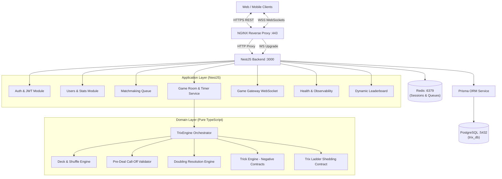

# TRIXI: Real-Time Multiplayer Card Game Backend

<p align="center">
  
  
  
  
  
  
  
  
</p>

An enterprise-grade, high-concurrency real-time backend powering the Middle Eastern card game **Trix** (also known as Trex / تركس). The platform supports both **Solo** and **Partnership (Team)** modes across **Free Mercy** and **Crazy Complex** kingdoms.

---

## Key Highlights

- **Pure TypeScript Game Engine**: Completely decoupled domain layer in `src/game-engine/` with zero NestJS, database, or WebSocket dependencies. 100% deterministic rules covering all 5 contracts, doubling calculations, pre-deal call-offs, and 13-Diamond sweeps.
- **Zero-Trust Anti-Cheat Serializer**: Server acts as the single source of truth; opponents' hidden cards are strictly stripped from all network payloads.
- **Real-Time Multiplayer Networking**: Built on Socket.IO over NGINX with 300s keep-alive buffers, turn timers (10/20/30s), doubling timers (8s), and automated bot delegation on disconnect.
- **Matchmaking & Caching**: Redis-backed atomic 4-player matchmaking queue with in-memory fallback, and 3-minute cached global leaderboards.
- **Production Containerization**: Multi-stage Dockerfile (<180MB) and Docker Compose stack for App, PostgreSQL 16, Redis 7, and NGINX reverse proxy.
- **Comprehensive Test Coverage**: 62 automated unit and integration tests passing in Vitest, plus automated headless 4-bot WebSocket stress simulator.

---

## Architecture Overview



---

## Documentation Quick Links

Complete technical documentation is available in the [`docs/`](./docs) directory:

- [**Full Backend Master Documentation**](./docs/FULL_BACKEND_DOCUMENTATION.md): Complete architecture, modules, models, and specifications.
- [**REST API & WebSocket Events Reference**](./docs/API_AND_EVENTS_REFERENCE.md): Full catalog of HTTP endpoints and Socket.IO payloads.
- [**Production Deployment Runbook**](./docs/DEPLOYMENT_RUNBOOK.md): Ubuntu VPS provisioning, file descriptor limits, Let's Encrypt SSL, and Docker Compose setup.
- [**Trix Mathematical Rules & Engine Specification**](./docs/TRIX_GAME_RULES_SPEC.md): 4 Kingdoms, 5 contracts, Free Mercy vs Crazy Complex, Solo vs Team doubling, and sweep resets.
- [**System Architecture & Database ERD**](./docs/SYSTEM_ARCHITECTURE_AND_DATABASE.md): PostgreSQL schema models, relationships, and indexing.

---

## Quickstart Guide

### 1. Prerequisites
- Node.js v20+ LTS
- PostgreSQL v16
- Redis v7 (optional, in-memory fallback enabled)

### 2. Installation
```bash
# Clone the repository
git clone https://github.com/Shyam-Sasidharan/Trixi.git
cd Trixi

# Install dependencies
npm install

# Copy environment variables
cp .env.example .env

# Edit .env: set DATABASE_URL to your local PostgreSQL user/password/port.
# URL-encode special characters in the password (e.g. "@" -> "%40").
# Replace JWT_SECRET / JWT_REFRESH_SECRET with your own random values.
```

### 3. Database Setup
```bash
# Generate Prisma Client
npx prisma generate

# Push database schema to PostgreSQL
npx prisma db push

# (Optional) Open Prisma Studio visual GUI
npx prisma studio
```

### 4. Running the Application
```bash
# Development (watch mode)
npm run start:dev

# Production build
npm run build
npm run start:prod
```

### 5. Running Automated Tests & Stress Simulator
```bash
# Run all 62 unit and integration tests
npm test

# Run headless 4-bot WebSocket load & anti-cheat simulator
npm run test:stress
```

---

## Production Deployment with Docker Compose

Deploy the complete stack (App, PostgreSQL, Redis, and NGINX with SSL):

```bash
docker compose -f docker-compose.prod.yml up -d --build
```

Check system health:
```bash
curl http://localhost:3000/health
```

Expected response:
```json
{
  "status": "ok",
  "postgres": "connected",
  "redis": "connected",
  "activeRooms": 0,
  "uptimeSeconds": 120,
  "memory": {
    "heapUsedMB": "42.10",
    "heapTotalMB": "48.50",
    "rssMB": "94.20"
  },
  "timestamp": "2026-10-22T12:00:00.000Z"
}
```

---

## License

This project is proprietary and confidential.
