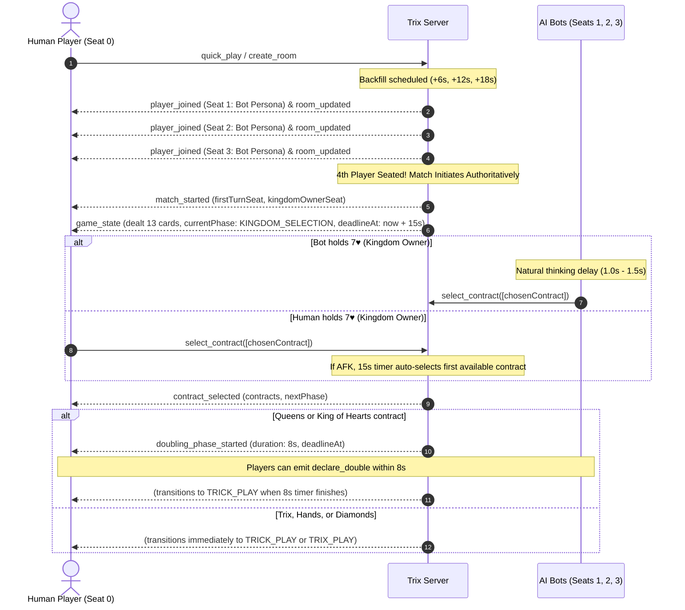

# TRIXI Backend Fixes & Frontend Action Items

**Target Audience:** Frontend / Flutter Mobile Developers & AI Agents  
**Backend Release:** v2.3.0 (Match-Start Stabilization & Authoritative Engine)  
**Date:** November 1, 2026  
**Status:** **Zero Breaking Changes to Schemas** | **Action Items Recommended Below**

---

## Executive Summary: Is Any Frontend Change Required?

> [!IMPORTANT]
> **Quick Answer:** **NO BREAKING CHANGES** were made to existing Socket.IO event names, payload schemas, or game mechanics. 
> However, **3 important client-side updates** are strongly recommended to remove legacy workarounds and ensure correct authentication.

| Area | Impact Level | Action Required on Frontend |
|---|---|---|
| **Match Start & Bot Seating (BE-1)** | 🟢 **Remove Workaround** | **STOP polling `reconnect_game`** when waiting for a match. The backend now pushes `player_joined`, `room_updated`, `match_started`, and `game_state` automatically in real time. |
| **JWT Socket Auth Guard (BE-5)** | 🟡 **Critical Check** | Ensure the client passes the JWT token in `auth: { token: "..." }` or `extraHeaders: { "Authorization": "Bearer ..." }`. Query string `?userId=...` is deprecated; unauthenticated connections are assigned guest accounts. |
| **Bot Kingdom Selection (BE-2)** | 🟢 **Fixed on Backend** | No code change needed. Matches no longer freeze at `KINGDOM_SELECTION` when a bot holds 7♥. The bot automatically selects within 1.0s–1.5s, and `deadlineAt` is guaranteed non-null (15s epoch timestamp). |
| **Card Power / Anti-Cheat (BE-4)** | ⚪ **Info Only** | The client does not need to compute or guarantee `card.power`. The backend strictly enforces server-authoritative card rank power. |

---

## 1. What Changes Were Done on the Backend?

### 1.1 BE-1: Real-Time Bot Seating & Match Start Broadcasts
- **Previous Issue:** When playing Quick Play, bots joined at +6s, +12s, +18s, but the socket server failed to broadcast events to the human player. The Flutter client had to repeatedly poll `reconnect_game` to discover that the match had started.
- **Backend Fix:**
  - Resolved dynamic gateway dependency resolution in `BotFillService`.
  - For each bot added (Seats 1, 2, 3), the backend immediately emits:
    1. `player_joined` with the bot's synthetic persona profile (avatar, display name, stats).
    2. `room_updated` with the complete 4-seat snapshot.
  - As soon as Seat 3 (the 4th player) is filled:
    1. Transitions room to `IN_PROGRESS`.
    2. Deals 13 cards per player via `TrixEngine`.
    3. Emits `match_started` to the room channel.
    4. Automatically invokes `broadcastMaskedState`, sending `game_state` with the human's private 13-card hand directly to their socket.

### 1.2 BE-2: Bot Kingdom Selection Deadlock Resolved
- **Previous Issue:** In ~75% of Quick Play matches, a bot receives the 7 of Hearts ($7\heartsuit$) and becomes the first `kingdomOwnerSeat`. The game locked indefinitely in `KINGDOM_SELECTION` with `deadlineAt: null`.
- **Backend Fix:**
  - `GameRoomService` now triggers an authoritative `onKingdomSelection` notification.
  - When a bot is the kingdom owner:
    - Evaluates the dealt hand using `BotBrainService.chooseContract`.
    - Waits for a natural thinking delay ($1000\text{ms} - 1500\text{ms}$).
    - Dispatches `selectContract(roomId, botSeat, chosenContract)`.
  - In `RoomTimerService`, a 15-second countdown timer is strictly initiated with an authoritative epoch deadline (`deadlineAt` / `deadlineTimestamp`).
  - If a human player goes AFK and does not select within 15 seconds, the server automatically selects the first unplayed contract as a fallback. Matches will never freeze.

### 1.3 BE-4: Server-Authoritative Card Power & Dominance
- **Previous Issue:** A vulnerability allowed client-sent `card.power` to override trick evaluation (e.g. 4♥ with forged `power: 99` beat A♥).
- **Backend Fix:**
  - In `TrickEngine.determineWinner` and `TrixEngine.playTrickCard`, trick dominance is calculated exclusively using deck constants (`RANK_POWERS[card.rank]`).
  - Client-sent `card.power` values are completely ignored.

### 1.4 BE-5: Socket Identity Authentication Guard
- **Previous Issue:** Sockets were allowed to claim arbitrary `userId` parameters via `handshake.query`, bypassing identity verification.
- **Backend Fix:**
  - Sockets must supply a Bearer JWT token in `handshake.auth.token` or `handshake.headers.authorization`.
  - Sockets with valid tokens are bound strictly to `payload.sub`.
  - Connections without a valid JWT are treated as ephemeral guests (`guest-${socket.id.slice(0, 6)}`), preventing identity spoofing.

---

## 2. Frontend Action Items: What Should the Frontend Developer Do?

### Action Item 1: Remove `reconnect_game` Polling at Match Start

> [!TIP]
> **Remove Polling Timers:** If your Flutter client has a `Timer.periodic` calling `socket.emit('reconnect_game', ...)` while waiting for bots or match start, **remove or disable it during lobby waiting**.

Instead, simply listen for the standard real-time events:

```dart
// 1. Listen for opponent/bot joining
socket.on('player_joined', (data) {
  final int seat = data['seat'];
  final user = data['user'];
  print('Player seated at Seat $seat: ${user['displayName']}');
  updateLobbySeat(seat, user);
});

// 2. Listen for room roster updates
socket.on('room_updated', (data) {
  final List players = data['players'];
  updateAllSeats(players);
});

// 3. Listen for automatic match start
socket.on('match_started', (data) {
  print('Match started! First turn: Seat ${data['currentTurnSeat']}, Kingdom Owner: Seat ${data['kingdomOwnerSeat']}');
  navigateToGameBoard();
});

// 4. Listen for your private dealt hand
socket.on('game_state', (data) {
  print('Received initial game state. Phase: ${data['currentPhase']}');
  updateGameState(data);
});
```

*Note: `reconnect_game` is still supported and should be used exclusively when the app comes back from the background or reconnects after internet loss.*

---

### Action Item 2: Verify Socket Handshake Authentication (JWT)

Make sure your Flutter Socket.IO initialization passes the JWT token properly in the `auth` payload:

```dart
import 'package:socket_io_client/socket_io_client.dart' as IO;

IO.Socket createTrixSocket(String jwtToken, String serverUrl) {
  return IO.io(
    serverUrl,
    IO.OptionBuilder()
      .setTransports(['websocket', 'polling'])
      .enableAutoConnect()
      .enableReconnection()
      .setAuth({
        'token': jwtToken, // <--- Correct: passes Bearer JWT to server guard
      })
      .setExtraHeaders({
        'Authorization': 'Bearer $jwtToken', // Optional additional fallback
      })
      .build(),
  );
}
```

> [!WARNING]
> Do not rely on passing `query: {'userId': userId}` without a token. In production, unauthenticated sockets are now assigned temporary guest IDs (`guest-xxxxxx`).

---

### Action Item 3: Handle `KINGDOM_SELECTION` Timer & Bot Flow Smoothly

Because the bot owner now selects a contract within 1.0s–1.5s:
1. When `game_state` arrives with `currentPhase: "KINGDOM_SELECTION"`:
   - If `mySeat == kingdomOwnerSeat`: Show the contract selection picker.
   - If `mySeat != kingdomOwnerSeat`: Show `"Waiting for [Owner] to choose contract..."` with the 15-second countdown timer.
2. In `game_state` and `timer_tick`, use `deadlineAt` (millisecond timestamp) to drive the circular timer:

```dart
final int? deadlineAt = data['deadlineAt']; // e.g. 1793454506902
final int? serverTime = data['serverTime']; // e.g. 1793454491902

if (deadlineAt != null && serverTime != null) {
  final int offset = DateTime.now().millisecondsSinceEpoch - serverTime;
  final int remainingMs = deadlineAt - (DateTime.now().millisecondsSinceEpoch - offset);
  final int remainingSeconds = (remainingMs / 1000).ceil().clamp(0, 15);
  startCountdownUI(remainingSeconds);
}
```

3. When `contract_selected` is received:
   - Dismiss the picker dialog immediately.
   - Display a brief banner showing the chosen contract (e.g., `"Contract: Girls / Queens"`).
   - The game will automatically transition to `DOUBLING_PHASE` (8s) or `TRICK_PLAY` (20s).

---

## 3. Summary of Socket Events Flow



---

## 4. Verification & Testing Checklist for Frontend QA

- [ ] **Quick Play Room Fill:** Sit in lobby. Verify avatars for Seats 1, 2, and 3 appear sequentially at +6s intervals without calling `reconnect_game`.
- [ ] **Match Auto-Transition:** Table automatically transitions to match view upon Seat 3 joining.
- [ ] **Bot 7♥ Start:** Play 5 Quick Play games. Verify the game never locks at match start, even when a bot is the kingdom owner.
- [ ] **Countdown Wheel:** Verify the 15-second kingdom selection timer ticks down smoothly on screen.
- [ ] **Card Click Lock:** Ensure cards cannot be dragged or tapped during `KINGDOM_SELECTION` or `DOUBLING_PHASE`.
- [ ] **Trick Clear Timing:** After 4 cards are played in a trick, verify the 4 cards remain visible on table for 1.5 seconds (`displayDurationMs: 1500`) before clearing.

