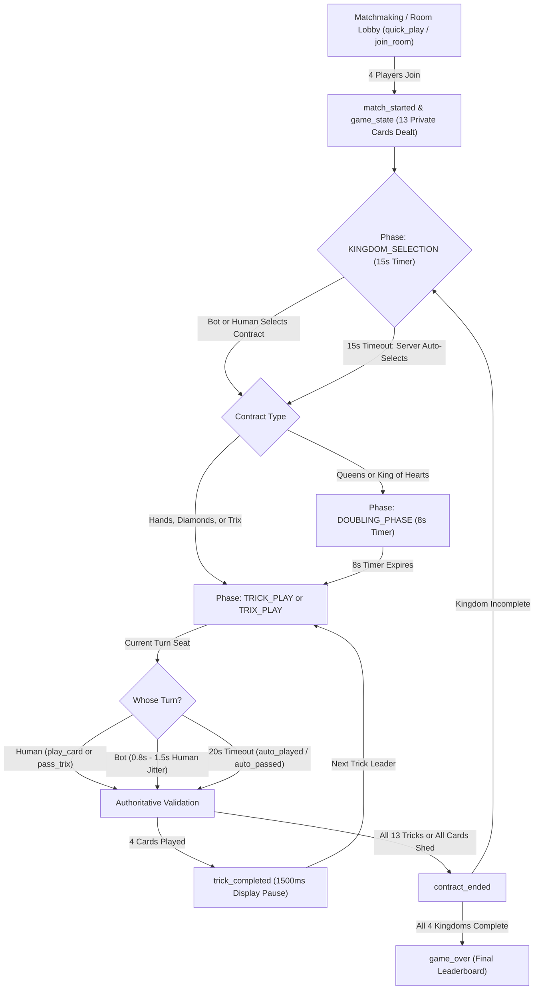

# TRIXI Multiplayer — Frontend Developer & AI Agent Integration Guide

**Target Audience:** Flutter (iOS / Android) Developers & AI Coding Agents  
**Backend Architecture:** NestJS / Socket.IO v4 / TypeScript  
**Authoritative Backend Version:** v2.2.0 (Post-Stabilization & Bot Unification)  
**Date:** October 31, 2026  

---

## 1. System Overview & What Has Changed

The Trix multiplayer backend has been upgraded with **server-authoritative deterministic flow**, **zero-deadlock timer fallbacks**, and a **fully unified bot-human execution pipeline**.

### Key Changes You Need to Know:
1. **Kingdom Selection (`KINGDOM_SELECTION`) is Now Active with a 15-Second Timer:**
   - When cards are dealt, the player holding the 7 of Hearts ($7\heartsuit$) is assigned as `kingdomOwnerSeat`.
   - The match enters `KINGDOM_SELECTION`.
   - The server now actively emits `timer_tick` with `phase: "KINGDOM_SELECTION"` and a **15-second countdown** (`remainingSeconds: 15 ... 0`).
   - **If a Bot is Owner:** The bot pauses for a natural thinking delay (1.0s–1.5s), evaluates its hand, and automatically submits `select_contract`.
   - **If a Human is Owner & Goes AFK:** If the human does not pick a contract within 15 seconds, the server's automatic fallback triggers, auto-selects the first available contract, and advances the game. **The room will NEVER hang or freeze.**
2. **Doubling Phase (`DOUBLING_PHASE`) has an Active 8-Second Window:**
   - Emits `timer_tick` with `phase: "DOUBLING_PHASE"`.
   - Players holding eligible Queens ($Q\spadesuit, Q\heartsuit, Q\diamondsuit, Q\clubsuit$) or King of Hearts ($K\heartsuit$) can emit `declare_double`.
   - Bots evaluate their hands and declare doubles within 2.0s–4.5s.
   - When the 8 seconds expire, the game automatically transitions to `TRICK_PLAY`.
3. **Card Play Pipeline (`TRICK_PLAY` & `TRIX_PLAY`) is 100% Unified:**
   - Human taps, bot plays, and 20-second timeout auto-plays all execute through the same authoritative validation engine.
   - Bots simulate realistic latency (0.8s–1.5s), so their play feels human.
4. **Resolution of the "Invalid Card" Flutter UI Bug:**
   - The server enforces strict card validation. Client UI **must disable card taps** during `KINGDOM_SELECTION` and `DOUBLING_PHASE`. Clicking cards when it is not trick play phase caused client-side invalid-card error banners.
5. **Monotonic Event Sequencing (`roomSequence`):**
   - Every outbound event contains an increasing integer `roomSequence`. Your client can discard out-of-order network packets.
6. **Clock Synchronization (`serverTime`, `deadlineAt`):**
   - All timer events contain server epoch timestamps so your UI countdown circle never drifts due to phone clock discrepancies.

---

## 2. Real-Time Socket Connection & Handshake

- **Transport:** WebSocket preferred with Engine.IO long-polling fallback: `['websocket', 'polling']`
- **Server URL:**
  - Local Dev: `http://localhost:3000`
  - Production Server: `http://157.230.239.31:3000` (or your domain)
- **Auth Token:** Supply JWT token in the connection `auth` dictionary.

### Flutter / Dart Socket.IO Setup Code:
```dart
import 'package:socket_io_client/socket_io_client.dart' as IO;

class TrixSocketManager {
  late IO.Socket socket;
  int lastSeenSequence = 0;

  void connect(String token, String serverUrl) {
    socket = IO.io(
      serverUrl,
      IO.OptionBuilder()
        .setTransports(['websocket', 'polling'])
        .enableAutoConnect()
        .enableReconnection()
        .setReconnectionDelay(1000)
        .setReconnectionDelayMax(5000)
        .setAuth({'token': token})
        .build(),
    );

    socket.onConnect((_) {
      print('[Socket] Connected with ID: ${socket.id}');
    });

    socket.onDisconnect((_) {
      print('[Socket] Disconnected from server');
    });

    socket.onConnectError((err) {
      print('[Socket] Connect Error: $err');
    });

    _registerEventHandlers();
  }

  void _registerEventHandlers() {
    // Register all inbound events documented below
  }
}
```

---

## 3. End-to-End Match State Machine



---

## 4. Phase-by-Phase Integration Requirements

### Phase 1: `KINGDOM_SELECTION` (15 Seconds)
- **Who selects:** Only the player where `mySeat == kingdomOwnerSeat`.
- **Timer event:** Receives `timer_tick` with `phase: "KINGDOM_SELECTION"`.
- **UI Behavior:**
  - If `mySeat == kingdomOwnerSeat`:
    - Display the Contract Selection Dialog (Trix, Girls/Queens, King of Hearts, Diamonds, Hands).
    - If playing `CRAZY_COMPLEX`, allow picking either Trix or the 4 combined negatives.
    - User taps a contract $\rightarrow$ Client emits `select_contract`.
  - If `mySeat != kingdomOwnerSeat`:
    - Display banner: `"Waiting for [Owner Name] to choose kingdom... (15s remaining)"`.
    - Disable/dim card hand.
  - When `contract_selected` is received, dismiss the selection dialog and animate the contract banner.

#### Client Inbound Event (`select_contract`):
```json
{
  "roomId": "e86639b4-3bc6-4af2-8f0e-6ada521d7531",
  "contracts": ["HANDS"],
  "actionId": "unique-client-uuid-v4"
}
```

---

### Phase 2: `DOUBLING_PHASE` (8 Seconds)
- Only occurs when the selected contract includes `QUEENS` or `KING_OF_HEARTS`.
- **Timer event:** Receives `timer_tick` with `phase: "DOUBLING_PHASE"`.
- **UI Behavior:**
  - Check player's `myHand`:
    - If player holds any Queen ($Q\spadesuit, Q\heartsuit, Q\diamondsuit, Q\clubsuit$) or $K\heartsuit$, highlight the card with a "DOUBLE" badge/button.
    - If player taps "DOUBLE" $\rightarrow$ Client emits `declare_double`.
  - All clients listen to `card_doubled` to render a double indicator (e.g. "x2" icon) above the player's avatar.
  - When the 8s timer expires, the server automatically transitions to `TRICK_PLAY`.

#### Client Inbound Event (`declare_double`):
```json
{
  "roomId": "e86639b4-3bc6-4af2-8f0e-6ada521d7531",
  "card": {
    "id": "HEARTS_Q",
    "suit": "HEARTS",
    "rank": "Q",
    "power": 12
  },
  "actionId": "unique-client-uuid-v4"
}
```

---

### Phase 3: `TRICK_PLAY` (Trick-Taking Contracts)
- Contracts: `KING_OF_HEARTS`, `QUEENS`, `DIAMONDS`, `HANDS` (or Complex negatives).
- **Turn Duration:** 20 seconds per move (`turnTime: 20`).
- **UI Card Click Guard:**
  ```dart
  bool canPlayCard(Card card) {
    // 1. Must be TRICK_PLAY phase
    if (gameState.currentPhase != 'TRICK_PLAY') return false;
    
    // 2. Must be this player's turn
    if (gameState.currentTurnSeat != gameState.mySeat) return false;
    
    // 3. Card must be legal according to Trix rules
    return isCardLegal(card, gameState.myHand, gameState.currentTrick, gameState.brokenSuits);
  }
  ```
- **Trick Completion Pause (`displayDurationMs: 1500`):**
  - When the 4th card of a trick is played, the server emits `trick_completed`.
  - **DO NOT immediately wipe the table!**
  - Keep all 4 cards visible on screen for `1500ms` so users can see who won the trick.
  - The server waits 1500ms before clearing the trick and emitting the next `game_state`.

#### Client Inbound Event (`play_card`):
```json
{
  "roomId": "e86639b4-3bc6-4af2-8f0e-6ada521d7531",
  "card": {
    "id": "HEARTS_A",
    "suit": "HEARTS",
    "rank": "A",
    "power": 14
  },
  "actionId": "unique-client-uuid-v4"
}
```

---

### Phase 4: `TRIX_PLAY` (Card Shedding Layout)
- Played when contract is `TRIX`.
- The table features 4 suit columns (`HEARTS`, `DIAMONDS`, `CLUBS`, `SPADES`).
- **Play Rules:**
  - Jack ($J$) of any suit opens that suit's column.
  - Once open, players can build **UP** ($Q \rightarrow K \rightarrow A$) or **DOWN** ($10 \rightarrow 9 \rightarrow \dots \rightarrow 2$).
- **If Player Has Legal Moves:** Highlight playable cards. Tapping plays the card via `play_card`.
- **If Player Has NO Legal Moves:** Show the **"PASS"** button. Tapping sends `pass_trix`.

#### Client Inbound Event (`pass_trix`):
```json
{
  "roomId": "e86639b4-3bc6-4af2-8f0e-6ada521d7531",
  "actionId": "unique-client-uuid-v4"
}
```

- **Special Event (`one_card_announcement`):**
  - When any player has exactly 1 card remaining in Trix, the server broadcasts `one_card_announcement`.
  - Play audio cue: `"Wahed!"` / `"One Card!"` and show an alert banner.

---

## 5. Socket.IO Outbound Event Payloads Reference

### 5.1 `match_started`
Emitted to the room when 4 players join:
```json
{
  "roomId": "7df3207e-e33b-485b-9f44-596531c9b044",
  "gameMode": "SOLO",
  "kingdomType": "FREE_MERCY",
  "firstTurnSeat": 1,
  "currentTurnSeat": 1,
  "kingdomIndex": 1,
  "kingdomOwnerSeat": 1,
  "roomSequence": 5
}
```

---

### 5.2 `game_state`
Private state view sent to each socket:
```json
{
  "roomId": "7df3207e-e33b-485b-9f44-596531c9b044",
  "roomSequence": 6,
  "stateVersion": 2,
  "turnId": 1,
  "serverTime": 1793454486902,
  "deadlineAt": 1793454506902,
  "currentPhase": "KINGDOM_SELECTION",
  "currentTurnSeat": 1,
  "mySeat": 0,
  "myHand": [
    { "id": "HEARTS_7", "suit": "HEARTS", "rank": 7, "power": 7, "isDoubled": false },
    { "id": "CLUBS_A", "suit": "CLUBS", "rank": "A", "power": 14, "isDoubled": false }
  ],
  "handCounts": { "0": 13, "1": 13, "2": 13, "3": 13 },
  "activeContracts": [],
  "currentTrick": { "leadSuit": null, "cards": [] },
  "trixColumns": {
    "HEARTS": { "isOpen": false, "highPower": 11, "lowPower": 11, "cards": [] },
    "DIAMONDS": { "isOpen": false, "highPower": 11, "lowPower": 11, "cards": [] },
    "CLUBS": { "isOpen": false, "highPower": 11, "lowPower": 11, "cards": [] },
    "SPADES": { "isOpen": false, "highPower": 11, "lowPower": 11, "cards": [] }
  },
  "scores": { "0": 0, "1": 0, "2": 0, "3": 0 },
  "seatsInfo": {
    "0": { "seat": 0, "displayName": "You", "isBot": false, "isConnected": true },
    "1": { "seat": 1, "displayName": "Faisal Al-Otaibi", "isBot": false, "isConnected": true },
    "2": { "seat": 2, "displayName": "Yasmin Ghazal", "isBot": false, "isConnected": true },
    "3": { "seat": 3, "displayName": "Tariq Mansoor", "isBot": false, "isConnected": true }
  }
}
```

---

### 5.3 `timer_tick`
Emitted every second during active countdowns:
```json
{
  "roomId": "7df3207e-e33b-485b-9f44-596531c9b044",
  "remainingSeconds": 14,
  "phase": "KINGDOM_SELECTION",
  "seat": 1,
  "deadlineTimestamp": 1793454506902,
  "deadlineAt": 1793454506902,
  "serverTime": 1793454492902,
  "roomSequence": 7
}
```

---

### 5.4 `trick_completed`
Emitted when trick has 4 cards:
```json
{
  "roomId": "7df3207e-e33b-485b-9f44-596531c9b044",
  "trickCards": [
    { "seat": 1, "card": { "id": "HEARTS_2", "suit": "HEARTS", "rank": 2, "power": 2 } },
    { "seat": 2, "card": { "id": "HEARTS_5", "suit": "HEARTS", "rank": 5, "power": 5 } },
    { "seat": 3, "card": { "id": "HEARTS_9", "suit": "HEARTS", "rank": 9, "power": 9 } },
    { "seat": 0, "card": { "id": "HEARTS_A", "suit": "HEARTS", "rank": "A", "power": 14 } }
  ],
  "trickWinnerSeat": 0,
  "winnerSeat": 0,
  "nextTurnSeat": 0,
  "roundScores": { "0": -15, "1": 0, "2": 0, "3": 0 },
  "displayDurationMs": 1500,
  "turnId": 2,
  "stateVersion": 3,
  "roomSequence": 12
}
```

---

### 5.5 `auto_played` & `auto_passed`
Emitted if a turn timer expires:
```json
{
  "roomId": "7df3207e-e33b-485b-9f44-596531c9b044",
  "seat": 2,
  "card": { "id": "CLUBS_2", "suit": "CLUBS", "rank": 2, "power": 2 },
  "phase": "TRICK_PLAY",
  "turnId": 4,
  "stateVersion": 5,
  "roomSequence": 16
}
```

---

## 6. Client Robustness & Network Checklist

### 1. Packet De-duplication & Ordering
Always maintain `lastSeenSequence`:
```dart
void onServerEvent(Map<String, dynamic> data) {
  if (data.containsKey('roomSequence')) {
    final int incomingSeq = data['roomSequence'];
    if (incomingSeq <= lastSeenSequence) {
      // Discard older/duplicate packet
      return;
    }
    lastSeenSequence = incomingSeq;
  }
  // Process event
}
```

### 2. Smooth Timer Rendering (Clock Drift Free)
Calculate remaining time using `deadlineAt` and `serverTime`:
```dart
final int serverTime = data['serverTime'];
final int deadline = data['deadlineAt'];
final int clientClockOffset = DateTime.now().millisecondsSinceEpoch - serverTime;

int getRemainingSeconds() {
  final int nowAdjusted = DateTime.now().millisecondsSinceEpoch - clientClockOffset;
  final int remaining = ((deadline - nowAdjusted) / 1000).ceil();
  return remaining.clamp(0, 30);
}
```

### 3. Quick Reconnection Strategy
When the Flutter app returns from background (`AppLifecycleState.resumed`) or network drops and reconnects:
```dart
socket.emit('reconnect_game', {'roomId': currentRoomId});
```
The server will immediately reply with the fresh, masked `game_state`, restoring the player's cards and the active trick without waiting for the next turn.

---

## 7. Error Code Reference

If the server rejects an action, it returns `{ "success": false, "code": "ERROR_CODE", "message": "..." }`:

| Error Code | Trigger Condition | Recommended Client Action |
|---|---|---|
| `NOT_YOUR_TURN` | Player sent `play_card` when `currentTurnSeat != mySeat`. | Block tap in UI; ensure turn indicator matches `currentTurnSeat`. |
| `INVALID_PLAY` | Card broke trick rules (e.g. didn't follow lead suit). | Show brief toast: `"Must follow suit"`. Card returns to hand. |
| `NOT_KINGDOM_OWNER` | Player sent `select_contract` but is not Kingdom Owner. | Close contract dialog; player is not the owner. |
| `CONTRACT_ALREADY_PLAYED` | Contract was already played in this Kingdom. | Disable the played contract button in selection grid. |
| `PHASE_MISMATCH` | Action sent in wrong phase (e.g. `play_card` during doubling). | Guard buttons based on `currentPhase`. |
| `ACTION_IN_PROGRESS` | Rapid multi-tap detected. | Client should ignore; operation is being serialized on server. |

---

## 8. Summary for AI Coding Agents
- Use Socket.IO v4 client.
- Always check `currentPhase` before allowing actions:
  - `KINGDOM_SELECTION` $\rightarrow$ Contract dialog for owner; 15s timer banner for non-owners.
  - `DOUBLING_PHASE` $\rightarrow$ Enable "Double" button on Queens and King of Hearts; 8s timer.
  - `TRICK_PLAY` $\rightarrow$ Enable legal cards on player's turn; 20s timer.
  - `TRIX_PLAY` $\rightarrow$ Enable playable cards or "Pass" button; 20s timer.
- All bots are disguised as humans (`isBot: false` to client) and automatically act within 0.8s–1.5s.
- Listen to `timer_tick`, `game_state`, `trick_completed`, `auto_played`, `auto_passed`, `contract_selected`, and `one_card_announcement`.

