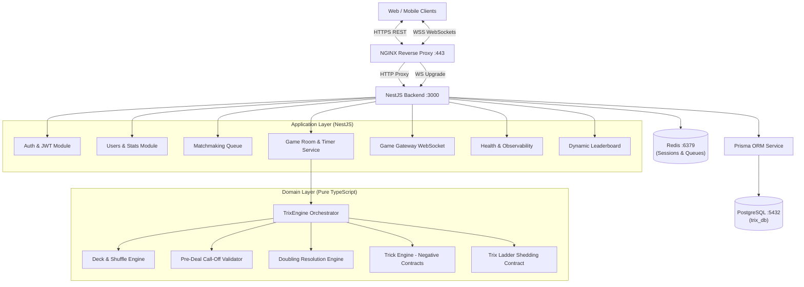
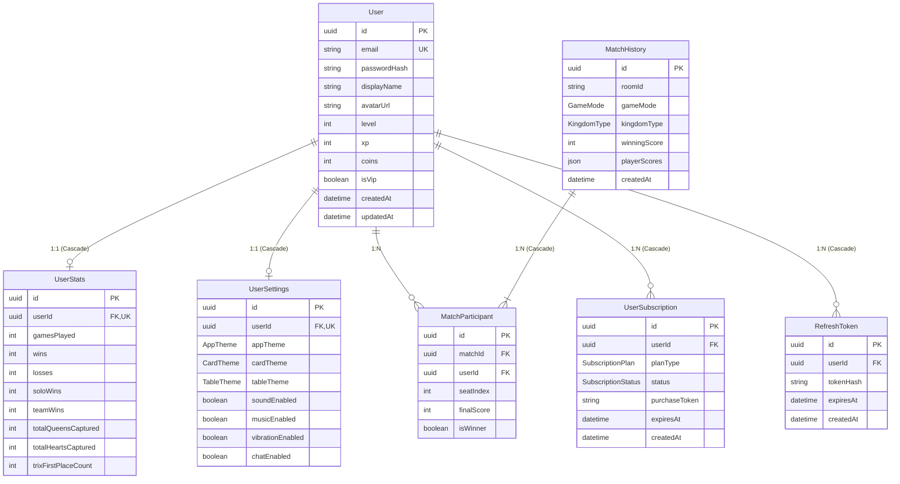

# TRIXI Backend: Complete Technical & Architectural Documentation

---

## Table of Contents
1. [Project Overview & Architecture Principles](#1-project-overview--architecture-principles)
2. [Technology Stack](#2-technology-stack)
3. [System Directory & Codebase Topology](#3-system-directory--codebase-topology)
4. [Database Architecture & Data Models (PostgreSQL & Prisma)](#4-database-architecture--data-models-postgresql--prisma)
5. [Pure TypeScript Core Game Engine (`src/game-engine/`)](#5-pure-typescript-core-game-engine-srcgame-engine)
6. [Real-Time Multiplayer & Anti-Cheat Networking](#6-real-time-multiplayer--anti-cheat-networking)
7. [Matchmaking & Redis Ephemeral Caching](#7-matchmaking--redis-ephemeral-caching)
8. [REST API Endpoint Directory](#8-rest-api-endpoint-directory)
9. [WebSocket Event Directory](#9-websocket-event-directory)
10. [DevOps, Docker & Infrastructure Deployment](#10-devops-docker--infrastructure-deployment)
11. [Automated Testing & Stress Simulation](#11-automated-testing--stress-simulation)

---

## 1. Project Overview & Architecture Principles

**Trixi** is an enterprise-grade, real-time multiplayer backend built for the traditional Middle Eastern card game **Trix** (also known as Trex / تركس). The platform supports both **Solo Mode** (individual play) and **Partnership/Team Mode** (Seats 0 & 2 vs 1 & 3) across two kingdom game types: **Free Mercy** (مملكة حرة) and **Crazy Complex** (كومبلكس).

### Core Architectural Pillars

1. **Domain-Driven Isolation (Clean Architecture)**:
   The entire game logic ([`src/game-engine/`](file:///c:/xampp/htdocs/trix-backend/src/game-engine)) is implemented as a 100% pure TypeScript domain. It contains **zero NestJS decorators**, **zero database imports**, and **zero WebSocket dependencies**. State transitions, card plays, rule checks, and scoring calculations are deterministic functions that are testable in isolation.

2. **Zero-Trust Anti-Cheat Card Masking**:
   Opponents' hidden cards are **never sent over the network**. The server acts as the single source of truth. Every client receives an individually tailored, sanitized game state containing only their own 13 cards and the remaining card counts of their opponents.

3. **High-Throughput Real-Time WebSockets**:
   Powered by Socket.IO over NGINX reverse proxy with WebSocket keep-alive buffers (`proxy_read_timeout 300s`) to prevent connection dropouts during player card selection and turn contemplation.

4. **Resilient Ephemeral & Persistent Data Storage**:
   Persistent entities (users, matches, stats, settings) are managed in **PostgreSQL** via **Prisma ORM** with connection pooling. Ephemeral operations (session tokens, matchmaking queues, leaderboard caching) are powered by **Redis** (`ioredis`) with in-memory fallbacks.



---

## 2. Technology Stack

| Layer | Component | Version / Technology | Purpose |
| :--- | :--- | :--- | :--- |
| **Framework** | NestJS | v12.0.1 | Modular backend architecture, dependency injection, routing |
| **Language** | TypeScript | v6.0.2 / NodeNext | Strict type safety, CommonJS/ESM interop |
| **Runtime** | Node.js | v20+ LTS | Asynchronous server execution |
| **WebSockets** | Socket.IO / `@nestjs/websockets` | v4.8.4 | Bidirectional real-time table communications |
| **Database** | PostgreSQL | v16 | Relational data persistence |
| **ORM** | Prisma ORM | v7.10.1 (`@prisma/adapter-pg`) | Type-safe queries, connection pooling, schema migrations |
| **Cache & Queue**| Redis (`ioredis`) | v6.0.0 | Ephemeral sessions, matchmaking queues, leaderboard cache |
| **Reverse Proxy**| NGINX | Alpine LTS | SSL termination, WebSocket keep-alives, gzip compression |
| **Containers** | Docker & Docker Compose | Multi-stage (<180MB) | Production containerization and service orchestration |
| **Testing** | Vitest | v4.1.2 | High-performance unit and integration test runner |

---

## 3. System Directory & Codebase Topology

```text
C:\xampp\htdocs\trix-backend\
├── .env.example                     # Sanitized environment configuration template
├── .dockerignore                    # Excluded assets from Docker builds
├── Dockerfile                       # Multi-stage production container definition
├── docker-compose.prod.yml          # Production stack (app, postgres, redis, nginx)
├── package.json                     # Project manifest and scripts
├── tsconfig.json                    # TypeScript compiler options (NodeNext)
├── nginx/
│   └── nginx.conf                   # NGINX reverse proxy & WebSocket configuration
├── prisma/
│   └── schema.prisma                # PostgreSQL relational database schema
├── scripts/
│   └── stress-test.ts               # Headless 4-bot WebSocket load & anti-cheat simulator
├── docs/
│   ├── FULL_BACKEND_DOCUMENTATION.md # Master technical manual
│   ├── API_AND_EVENTS_REFERENCE.md  # REST endpoints & WebSocket event catalog
│   ├── DEPLOYMENT_RUNBOOK.md        # Ubuntu VPS setup, file limits & SSL guide
│   ├── TRIX_GAME_RULES_SPEC.md      # Game rules & scoring specification
│   └── SYSTEM_ARCHITECTURE_AND_DATABASE.md # Database ERD & models
└── src/
    ├── main.ts                      # Application entrypoint & global bootstrap
    ├── app.module.ts                # Root application module wiring
    ├── auth/                        # Authentication & JWT session handling
    ├── common/                      # Shared guards, decorators, and Redis service
    ├── game-engine/                 # Pure TypeScript Trix game domain (Phase 2)
    │   ├── types/                   # Card, contract, engine, and scoring types
    │   ├── deck.ts                  # Standard deck, Fisher-Yates shuffle, 7♥ deal
    │   ├── call-off.validator.ts    # Pre-deal K♥ and Trix automatic call-offs
    │   ├── doubling.ts              # Queens & K♥ doubling resolution
    │   ├── trick-engine.ts          # Trick play, follow-suit, 13-Diamond sweep
    │   ├── trix-engine.ts           # 4-Kingdom match orchestrator
    │   └── contracts/
    │       └── trix.contract.ts     # Jack columns, ladders, finish scoring
    ├── game-room/                   # Room management & WebSockets (Phase 3)
    │   ├── game.gateway.ts          # Socket.IO gateway with JWT handshake
    │   ├── game-room.module.ts      # Game room dependency module
    │   ├── serializers/             # Zero-trust anti-cheat player serializers
    │   └── services/                # GameRoomService & RoomTimerService
    ├── health/                      # System health & live observability (Phase 4)
    ├── leaderboard/                 # Global & friends leaderboard with Redis cache
    ├── matchmaking/                 # Redis-backed 4-player matchmaking queue
    ├── prisma/                      # PrismaService native connection adapter
    └── users/                       # User profile, settings, and player statistics
```

---

## 4. Database Architecture & Data Models (PostgreSQL & Prisma)

The database layer is managed through **Prisma ORM** connected to **PostgreSQL** (`trix_db`) via `@prisma/adapter-pg` using a pooled client in [`src/prisma/prisma.service.ts`](file:///c:/xampp/htdocs/trix-backend/src/prisma/prisma.service.ts).

### 4.1 Entity-Relationship Diagram (ERD)



### 4.2 Enums & Data Types
- `GameMode`: `'SOLO' | 'TEAM'`
- `KingdomType`: `'FREE_MERCY' | 'CRAZY_COMPLEX'`
- `AppTheme`: `'DARK' | 'LIGHT'`
- `CardTheme`: `'CLASSIC' | 'MODERN' | 'LUXURY'`
- `TableTheme`: `'GREEN_FELT' | 'ROYAL_BLUE' | 'BURGUNDY'`
- `SubscriptionPlan`: `'MONTHLY' | 'ANNUAL'`
- `SubscriptionStatus`: `'ACTIVE' | 'EXPIRED' | 'CANCELLED'`

### 4.3 Database Lifecycle & Transactions
- **Atomic Onboarding**: When a user registers via `POST /auth/register`, a Prisma `$transaction` guarantees that the `User`, their default `UserSettings` (`DARK` theme, `CLASSIC` cards, `GREEN_FELT` table), and their zeroed `UserStats` are created atomically.
- **Cascading Integrity**: All related entities (`UserSettings`, `UserStats`, `RefreshToken`, `UserSubscription`) configure `onDelete: Cascade` to prevent orphaned records.
- **Match Archival**: Completed 20-deal games are persisted with all seat scores recorded in a single transaction in `MatchHistory` and `MatchParticipant`, with automatic player XP (+50) and coin adjustments (+120 for win, -80 for loss).

---

## 5. Pure TypeScript Core Game Engine (`src/game-engine/`)

The game domain is strictly separated from HTTP/WebSocket concerns, ensuring deterministic execution and full testability.

### 5.1 Card Model & Power Ranking ([`card.types.ts`](file:///c:/xampp/htdocs/trix-backend/src/game-engine/types/card.types.ts))
- **Suits**: `HEARTS (♥)`, `DIAMONDS (♦)`, `CLUBS (♣)`, `SPADES (♠)`.
- **Ranks & Powers**:
  - `2=2`, `3=3`, `4=4`, `5=5`, `6=6`, `7=7`, `8=8`, `9=9`, `10=10`
  - `Jack (J) = 11`, `Queen (Q) = 12`, `King (K) = 13`, `Ace (A) = 14`.

### 5.2 Deal & Seat Progression ([`deck.ts`](file:///c:/xampp/htdocs/trix-backend/src/game-engine/deck.ts))
- **Fisher-Yates Shuffle**: Fully randomized using standard or seeded pseudo-random number generators.
- **Initial Kingdom Owner**: The holder of the **Seven of Hearts (7♥)** is designated the first Kingdom Owner.
- **Counter-Clockwise Progression**: Play and kingdom transitions proceed strictly to the player's right:
  $$\text{Next Seat} = (\text{Current Seat} + 3) \pmod 4 \quad (0 \to 3 \to 2 \to 1)$$
- **Team Seating**: Team 1 occupies Seats 0 & 2; Team 2 occupies Seats 1 & 3.

### 5.3 Pre-Deal Automatic Call-Off Engine ([`call-off.validator.ts`](file:///c:/xampp/htdocs/trix-backend/src/game-engine/call-off.validator.ts))
Automatic checks prevent unfair games caused by impossible hands:
1. **King of Hearts Call-Off**:
   - Triggers if a player holds solitary `K♥` (no other Hearts).
   - Triggers if a player holds `K♥` and `A♥` and no other Hearts.
   - Outcome: Hand is automatically voided and re-dealt without penalty.
2. **Trix Call-Off**:
   - Triggers if a player holds all four `2`s (`2♦, 2♣, 2♥, 2♠`).
   - Triggers if a player holds three `2`s plus the `3` of the remaining suit (e.g. `2♦, 2♣, 2♥, 3♠`).
   - Outcome: Deal is automatically voided and re-dealt.

### 5.4 Doubling Resolution Engine ([`doubling.ts`](file:///c:/xampp/htdocs/trix-backend/src/game-engine/doubling.ts))
In deals containing `QUEENS` or `KING_OF_HEARTS`, players holding Queens or `K♥` may publicly double them:
- **Solo Mode**:
  - Opponent captures doubled card: Collector receives penalty (**-50** for Q, **-150** for K♥); Doubler receives reward (**+25** for Q, **+75** for K♥).
  - Doubler captures own doubled card (self-take fault): Doubler pays full penalty (**-50** or **-150**); trick leader receives reward (**+25** or **+75**).
- **Team Mode**:
  - Opposing team captures: Collector's team receives **-50** / **-150**; Doubler's team receives **+25** / **+75**.
  - Doubler's team captures (partner or doubler): Doubler's team pays full penalty (**-50** / **-150**); Opponent team receives **+25** / **+75**.

### 5.5 Negative Contract Trick Engine ([`trick-engine.ts`](file:///c:/xampp/htdocs/trix-backend/src/game-engine/trick-engine.ts))
- **Contract Values**:
  - Queens: -25 each (-50 if doubled) $\to$ Total pool: -100 (-200 if all doubled).
  - King of Hearts: -75 (-150 if doubled).
  - Diamonds: -10 each $\to$ Total pool: -130 across 13 cards.
  - Hands: -15 per trick $\to$ Total pool: -195 across 13 tricks.
- **Rules**:
  - Mandatory follow-suit if holding cards of the led suit.
  - Off-suit sloughing allowed when void in led suit.
  - Highest card of the led suit takes the trick (no trump suit).
  - Free Mercy: Diamonds cannot be led until broken, unless the leader holds only Diamonds.
  - Crazy Complex: Diamonds can be led at any time, including Trick 1.
  - King of Hearts: Hearts cannot be led until broken, unless the leader holds only Hearts.
- **13-Diamond Sweep Reset**: If a single player captures all 13 Diamonds:
  - Free Mercy: Diamond contract scores are zeroed and re-dealt.
  - Crazy Complex: All 4 negative contract scores are zeroed and the combined contract is re-dealt.

### 5.6 Trix Shedding Contract Engine ([`contracts/trix.contract.ts`](file:///c:/xampp/htdocs/trix-backend/src/game-engine/contracts/trix.contract.ts))
- **Layout**: 4 suit columns initiated strictly with Jacks (`J`).
- **Ladder Progression**:
  - Upward: `J -> Q -> K -> A`
  - Downward: `J -> 10 -> 9 -> 8 -> 7 -> 6 -> 5 -> 4 -> 3 -> 2`
- **Mandatory Play Rule**: Passing is **strictly forbidden** if the player holds any playable card.
- **Finishing Scoring**:
  - 1st Place: **+200 pts**
  - 2nd Place: **+150 pts**
  - 3rd Place: **+100 pts**
  - 4th Place: **+50 pts**
  - Total Pool: **+500 pts**

---

## 6. Real-Time Multiplayer & Anti-Cheat Networking

### 6.1 Anti-Cheat Player-View Serializer ([`player-view.serializer.ts`](file:///c:/xampp/htdocs/trix-backend/src/game-room/serializers/player-view.serializer.ts))
The server serializes match state into a safe payload for each seat:
- `myHand`: Target player's 13 cards sorted by suit and power descending.
- `opponents`: Array of `{ seat, remainingCardCount, isConnected, isDoublingAnnounced }`.
- **Zero-Trust**: Opponents' card arrays are stripped entirely from memory before JSON transmission.

### 6.2 Room Timers & Bot Delegation ([`room-timer.service.ts`](file:///c:/xampp/htdocs/trix-backend/src/game-room/services/room-timer.service.ts))
- **Turn Countdown**: Configurable to 10s, 20s, or 30s. Emits `timer_tick` each second.
- **Doubling Countdown**: Fixed 8-second window.
- **Turn Timeout**:
  - In `TRIX_PLAY`: Auto-plays the lowest legal card; if void, automatically passes.
  - In `TRICK_PLAY`: Auto-plays the lowest legal follow-suit card.
- **Reconnection Grace Timer**:
  - If a player disconnects, `isConnected` becomes `false` and a 30-second grace timer begins.
  - If the timer expires, `isBot` becomes `true` and the server automates moves to prevent stalled games.
  - When the player returns, `handleReconnect()` clears the grace timer and synchronizes state.

---

## 7. Matchmaking & Redis Ephemeral Caching

Implemented in [`src/matchmaking/matchmaking.service.ts`](file:///c:/xampp/htdocs/trix-backend/src/matchmaking/matchmaking.service.ts):
- **Redis Queue Keys**: `trix_matchmaking_queue:{gameMode}:{kingdomType}`.
- **Atomic 4-Player Match Formation**: When 4 players queue for the same game configuration, they are atomically popped and seated in an active room. All 4 sockets receive `match_found` with their assigned `roomId`.
- **In-Memory Fallback**: If Redis is offline, an in-memory queue transparently handles matchmaking.
- **Leaderboard Caching**: [`LeaderboardService`](file:///c:/xampp/htdocs/trix-backend/src/leaderboard/leaderboard.service.ts) caches top 100 rankings in Redis (`leaderboard:global`) with a 3-minute TTL (180s).

---

## 8. REST API Endpoint Directory

All endpoints accept and return JSON. Authenticated routes require `Authorization: Bearer <accessToken>`.

| Route | Method | Auth | Description |
| :--- | :--- | :--- | :--- |
| `/auth/register` | `POST` | No | Creates player account, default settings, and zeroed stats |
| `/auth/login` | `POST` | No | Validates credentials and returns JWT access & refresh tokens |
| `/auth/refresh` | `POST` | No | Rotates refresh token and issues fresh access token |
| `/auth/logout` | `POST` | Yes | Revokes active session from Redis and PostgreSQL |
| `/users/me` | `GET` | Yes | Retrieves profile, stats, and settings of authenticated user |
| `/users/profile` | `PATCH` | Yes | Updates display name or avatar URL |
| `/users/settings`| `PATCH` | Yes | Updates theme, card design, table color, and sound preferences |
| `/leaderboard/global` | `GET` | No | Top 100 global players ranked by wins and win-rate (3m Redis cache) |
| `/leaderboard/friends` | `GET` | Yes | Rankings filtered around the authenticated player's neighborhood |
| `/health` | `GET` | No | Live probe for PostgreSQL, Redis, heap memory, and active room count |

---

## 9. WebSocket Event Directory

Connect via `ws://<host>:3000/socket.io/` or `wss://<host>/socket.io/`.

### 9.1 Client to Server Events
- `create_room`: Creates a room. Host is seated at Seat 0.
- `join_room`: Joins room by UUID or 6-character room code.
- `reconnect_game`: Restores a disconnected player to their active seat.
- `select_contract`: Sent by Kingdom Owner to pick contract(s).
- `declare_double`: Sent during doubling phase to expose a doubled Queen or K♥.
- `play_card`: Plays a card to the trick or Trix ladder.
- `pass_trix`: Passes turn in Trix shedding (rejected if legal moves exist).

### 9.2 Server to Client Events
- `game_state`: Anti-cheat sanitized table update dispatched to individual sockets.
- `timer_tick`: Second-by-second countdown event (`{ roomId, remainingSeconds, phase, seat }`).
- `match_started`: Fired when all 4 seats are filled and card deal begins.
- `player_joined`: Fired in lobby when a player enters a room.
- `doubling_phase_started`: Fired when an 8-second doubling window begins.
- `card_doubled`: Broadcasted when an exposed doubled card is declared.
- `trick_completed`: Broadcasted when a 4-card trick completes, indicating winner seat.
- `auto_played` / `auto_passed`: Broadcasted when turn timer expires or bot plays.
- `contract_ended`: Broadcasted upon contract completion with round scores.
- `game_over`: Broadcasted upon match completion with final scores and winner(s).

---

## 10. DevOps, Docker & Infrastructure Deployment

### 10.1 Multi-Stage Dockerfile (`Dockerfile`)
- **Stage 1 (Builder)**: Uses `node:20-alpine`, runs `npm ci`, `prisma generate`, and `npm run build`, followed by pruning devDependencies.
- **Stage 2 (Runner)**: Minimal footprint (<180MB) running as non-root `node` user with built-in healthcheck (`curl -f http://localhost:3000/health`).

### 10.2 Production Docker Compose (`docker-compose.prod.yml`)
- `app`: Production NestJS application container.
- `postgres`: PostgreSQL 16 Alpine with named volume persistence (`postgres_data`).
- `redis`: Redis 7 Alpine with append-only file persistence (`--appendonly yes`) and named volume (`redis_data`).
- `nginx`: NGINX Alpine reverse proxy with SSL termination and WebSocket pass-through.

### 10.3 NGINX Reverse Proxy (`nginx/nginx.conf`)
- HTTP-to-HTTPS redirect on port 80.
- Modern TLS ciphers on port 443.
- WebSocket location `/socket.io/` configured with `Upgrade $http_upgrade` and `Connection "upgrade"`.
- Card game anti-drop buffers: `proxy_read_timeout 300s;` and `proxy_send_timeout 300s;`.

---

## 11. Automated Testing & Stress Simulation

### 11.1 Test Suite Breakdown (`npm test`)
The test suite consists of **62 automated unit and integration tests across 15 test files** running in Vitest:
- `trick-engine.spec.ts` (9 tests): Follow-suit, lead restrictions, winner resolution, 13-Diamond sweep.
- `doubling.spec.ts` (10 tests): Solo and team doubling, self-take fault penalties, partner takes.
- `call-offs.spec.ts` (9 tests): Solitary/Ace-only K♥ redeal, four 2s, three 2s + 3 of fourth suit.
- `trix.spec.ts` (5 tests): Jack column initiation, ladder traversal, pass blocking, finish scores (+500).
- `player-view-serializer.spec.ts` (5 tests): Zero-trust card masking, zero opponent leakage.
- `game-room.service.spec.ts` (7 tests): Lifecycle, 4-player deal, disconnect grace timers, bot fallback.
- `game.gateway.spec.ts` (5 tests): Handshakes, room creation, contract choice, trick play.
- `matchmaking.service.spec.ts` (3 tests): 4-player atomic match formation and dequeue.
- `leaderboard.service.spec.ts` (3 tests): Win-rate calculations and 3-minute Redis caching.
- `health.service.spec.ts` (3 tests): PostgreSQL and Redis live probing and memory reporting.
- Auth, Users, and App spec tests (3 tests).

### 11.2 Headless Load & Anti-Cheat Simulator (`npm run test:stress`)
Located in [`scripts/stress-test.ts`](file:///c:/xampp/htdocs/trix-backend/scripts/stress-test.ts):
1. Registers 4 concurrent bot accounts via `/auth/register`.
2. Connects 4 real WebSocket sockets with JWT authorization.
3. Creates a room and seats all 4 players.
4. **Asserts that 100% of opponents' hidden cards are stripped across all 4 seats**.
5. Selects `HANDS` contract and executes a full automated 4-card trick, asserting winner resolution and clean disconnect.
